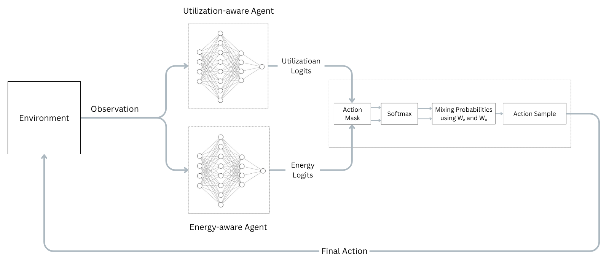
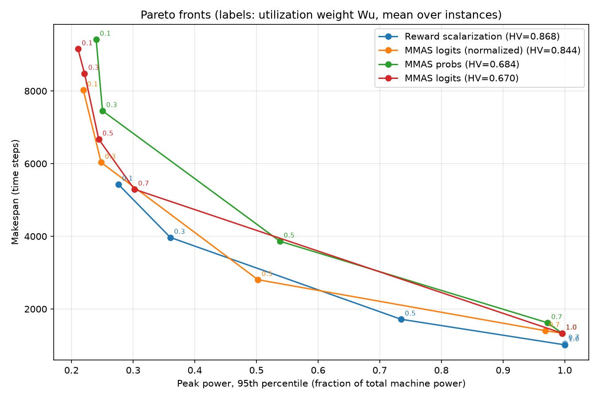
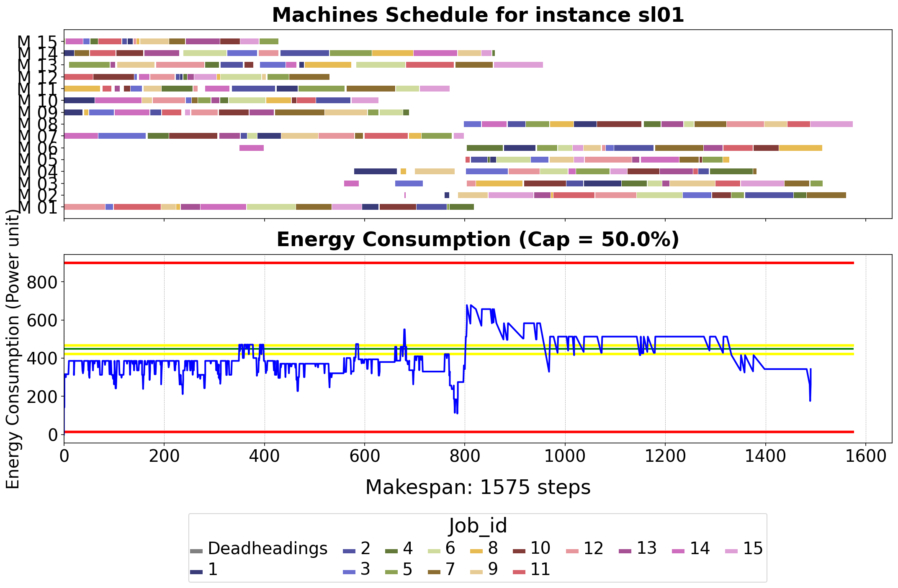

# Energy-Aware Job-Shop Scheduling with Multi-Objective RL

**Can two specialist RL agents be combined at inference time to cover a whole energy-vs-productivity
trade-off, instead of training one agent per preference?**

This repository contains the code of my Master's thesis *"Explainable Multi-Agent RL for Sustainable
Industrial Systems: Balancing Energy Efficiency and Productivity Optimization"* (South Westphalia
University of Applied Sciences, 2025, grade 1.0).

A job shop is modelled as a **Coloured Petri net** and solved with **Maskable PPO**. Two objectives
conflict: keep power consumption under an energy cap, and keep machines busy. I compare two ways of
tracing the Pareto front:

| Approach | Idea | Cost of a new trade-off point |
|---|---|---|
| **Reward scalarization** | Train one agent per weight `Wu·U + We·E` | A full training run (~1-3 h each) |
| **MMAS** (Mixed Multi-Agent Strategies) | Train *two* experts once, mix their policies with weights `We, Wu` at inference | Seconds |

<p align="center"></p>

## Results

Five preference weights `Wu ∈ {0.1, 0.3, 0.5, 0.7, 1.0}`, evaluated on four 15 × 15 Solax instances
(`sl01`–`sl04`) and averaged per weight. Lower is better on both axes.

<p align="center"></p>

| Method | Hypervolume ↑ | Mean machine utilization | Agents trained |
|---|---|---|---|
| Reward scalarization | **0.868** | **0.434** | 5 (one per weight) |
| MMAS, logits level, normalized | 0.844 | 0.312 | **2** |
| MMAS, probability level | 0.684 | 0.277 | **2** |
| MMAS, logits level, raw | 0.670 | 0.194 | **2** |

Machine utilization per weight (makespan in brackets):

| Wu | Scalarization | MMAS logits (norm.) | MMAS probs | MMAS logits (raw) |
|---|---|---|---|---|
| 0.1 | 0.136 (5432) | 0.092 (8027) | 0.079 (9419) | 0.081 (9158) |
| 0.3 | 0.185 (3968) | 0.122 (6032) | 0.099 (7454) | 0.087 (8484) |
| 0.5 | 0.427 (1716) | 0.272 (2804) | 0.202 (3864) | 0.110 (6673) |
| 0.7 | 0.695 (1055) | 0.524 (1403) | 0.457 (1620) | 0.140 (5295) |
| 1.0 | 0.725 (1013) | 0.551 (1333) | 0.551 (1333) | 0.551 (1333) |

**Takeaways**

- **Reward scalarization gives the best trade-off**, because it optimizes both objectives during
  training. It needs one full training run per preference.
- **MMAS with normalized logits comes within 3 % of its hypervolume using only two trained agents.**
  New trade-off points cost seconds instead of hours, and it reaches lower peak-power schedules
  (about 22 % of total power) that the scalarized agents did not.
- **Normalization is essential.** Without it the energy expert's larger logits dominate the mix, and
  machines stay mostly idle until `Wu = 1.0` (utilization 0.140 vs. 0.524 at `Wu = 0.7`).
- Mixing at the logits level works better than mixing probabilities.

> **Choosing objectives.** In this environment machines only draw power while busy, so average power
> and idleness are almost perfectly correlated (r = −0.9996). They are one quantity, and a Pareto
> front over them is degenerate. The real conflict an energy cap creates is **peak power vs. makespan**,
> which is what the plot uses.

## What I built on top of PetriRL

The Petri-net simulator is based on [PetriRL](https://doi.org/10.1016/j.jmsy.2024.04.028) by
Sofiene Lassoued and Andreas Schwung (see [Credits](#credits)). My contributions:

- **Multi-objective environment** (`petrirl/envs/moo`): per-machine power model, energy cap, energy and
  utilization logging, observation extended with total and per-machine consumption, and a *standby*
  action so the agent can choose to wait instead of starting a machine.
- **Reward design** (`petrirl/utils/reward.py`): shaped energy and utilization rewards, combined by
  linear or Chebyshev scalarization.
- **MMAS** (`scripts/mmas.py`): mixing two pretrained MaskablePPO policies at the **logits** or the
  **probability** level, with z-score logit normalization against logit dominance and action masking.
- **Evaluation pipeline**: per-episode metrics (makespan, utilization, energy, cap overshoot),
  Pareto-front extraction and **hypervolume** comparison (`scripts/plot_pareto.py`).
- **Visualization** (`petrirl/render/plot_moo.py`): Gantt chart combined with the energy profile
  against the cap.

<p align="center"><br>
<em>Schedule of the 50 % cap agent on Solax instance sl01 (15 jobs × 15 machines): Gantt chart and
power consumption against the cap (green).</em></p>

## Quickstart

```bash
python -m venv .venv
source .venv/bin/activate        # Windows: .venv\Scripts\activate
pip install -r requirements.txt
pip install -e .
```

Evaluate the pretrained agents on four instances and plot both Pareto fronts:

```bash
python scripts/evaluate.py                      # reward-scalarized agents -> results/scalarization.csv
python scripts/mmas.py --level logits --normalize   # MMAS               -> results/mmas_logits_norm.csv
python scripts/plot_pareto.py results/scalarization.csv results/mmas_logits_norm.csv
```

Train your own expert (2M steps, about 1-3 hours on a laptop CPU):

```bash
python scripts/train.py --usage-cap 0.1     # energy expert
python scripts/train.py --usage-cap 1.0     # utilization expert
```

### CPU or GPU

Every script takes `--device {auto,cpu,cuda}` (`auto` uses CUDA when available). For a GPU, install
the CUDA build of PyTorch first, for example
`pip install torch==2.6.0 --index-url https://download.pytorch.org/whl/cu124`.

**The CPU is faster for this project.** `python scripts/benchmark_device.py` on an i7-13620H vs. an
RTX 4050 Laptop GPU (two runs):

| Device | Training (steps/s) | MMAS inference (steps/s) |
|---|---|---|
| CPU | 326 – 541 | 473 – 760 |
| CUDA | 170 – 180 | 329 – 356 |

The policy is a small 64 × 64 MLP evaluated once per environment step, so copying each observation
to the GPU costs more than the GPU saves. A GPU only pays off with larger networks or many
environments running in parallel.

## How it works

**Environment.** Every operation is a coloured token carrying its job id, machine and processing time.
The agent fires *controllable* transitions: select the next operation of a job, start a machine, or
stand by. Timed transitions finish processing automatically. Invalid actions come straight from the
Petri net's guard function and are masked out of the policy.

**Objectives.** Each machine has a fixed power draw. With energy cap `c` (fraction of total power):

- energy utilization = average consumption / total power
- energy overshoot = average of `(consumption − c·total) / (c·total)` (positive means above the cap)
- machine utilization = average share of busy machines; idleness = 1 − utilization

The cap `c` is also the utilization weight `Wu` (`We = 1 − Wu`), so one number sets the preference.

**MMAS.** For a preference `Wu`, the energy expert (trained at `c = 0.1`) and the utilization expert
(`c = 1.0`) each produce action logits for the same observation:

```
logits level:  π = softmax(We · z_E + Wu · z_U)
probs  level:  π = We · softmax(z_E) + Wu · softmax(z_U)
```

`z` are the logits, optionally z-score normalized over the valid actions. Without normalization,
the expert with larger logits dominates whatever the weights are. Invalid actions are masked to
`-inf` *after* mixing, so they get probability 0 even when one of the weights is 0.

Actions are taken greedily (`argmax`). A greedy mix can keep choosing *standby* forever, so after
30 consecutive standbys the best other valid action is taken (`--noop-guard 0` disables this).

## Repository layout

```
petrirl/                 Gymnasium environment (registered as "petrirl-moo-v0")
  envs/moo/              Petri-net builder, simulator and Gym wrapper
  common/instances/      Benchmark instances (Solax, Taillard, Raj, BU, Demirkol)
  utils/reward.py        Reward functions
  render/                Gantt + energy plots, Petri-net drawing
scripts/
  train.py               Train a MaskablePPO agent for one preference weight
  evaluate.py            Evaluate reward-scalarized agents
  mmas.py                Mix two experts at inference time
  plot_pareto.py         Pareto fronts + hypervolume
  benchmark_device.py    CPU vs. CUDA speed comparison
pretrained/
  experts/               Energy expert (cap 0.1) and utilization expert (cap 1.0)
  scalarized/            One agent per weight 0.1, 0.3, 0.5, 0.7, 1.0
results/                 CSV outputs of the evaluation scripts
```

## Limitations

- Experiments use 15 × 15 Solax instances. Agents were trained on `sl01` and tested on `sl01`–`sl04`;
  larger instances need retraining because the observation size depends on the instance.
- Job precedence constraints were relaxed to isolate the multi-objective comparison.
- Results come from single training seeds.
- The numbers above are produced by this repository's code. They follow the same trends as the
  thesis tables but are not identical: the logit normalization here uses only the valid actions,
  and scalarized agents sample their actions, so their runs vary slightly with the seed.

## Credits

The Petri-net JSSP framework this work extends is **PetriRL** by Sofiene Lassoued and Andreas Schwung
([repository](https://github.com/Sofiene-Uni), [PyPI: jsspetri](https://pypi.org/project/jsspetri/)).
Rights to the original framework remain with its authors.

```bibtex
@article{lassoued2024petrirl,
  title   = {Introducing PetriRL: An innovative framework for JSSP resolution integrating
             Petri nets and event-based reinforcement learning},
  author  = {Lassoued, Sofiene and Schwung, Andreas},
  journal = {Journal of Manufacturing Systems},
  volume  = {74},
  pages   = {690--702},
  year    = {2024},
  doi     = {10.1016/j.jmsy.2024.04.028}
}
```

Benchmark instances are from Taillard (1993), Demirkol et al. (1998), and the PetriRL authors.

**Author:** Mina Lotfy Saad Gergis. Thesis supervised by Sofiene Lassoued, M.Sc., with
Prof. Dr. Andreas Schwung and Prof. Dr. Dominik Aufderheide.
